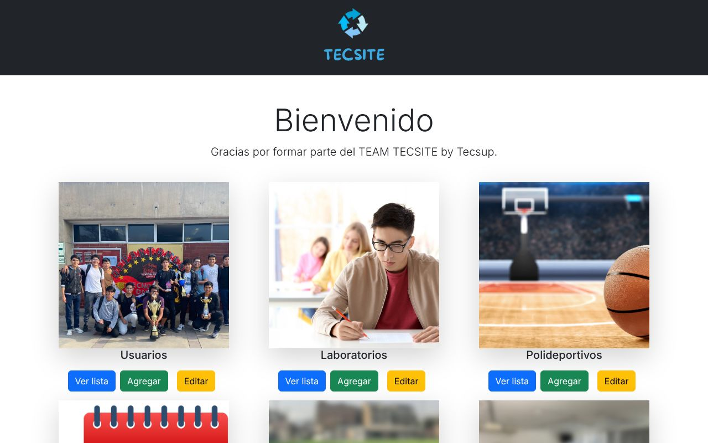
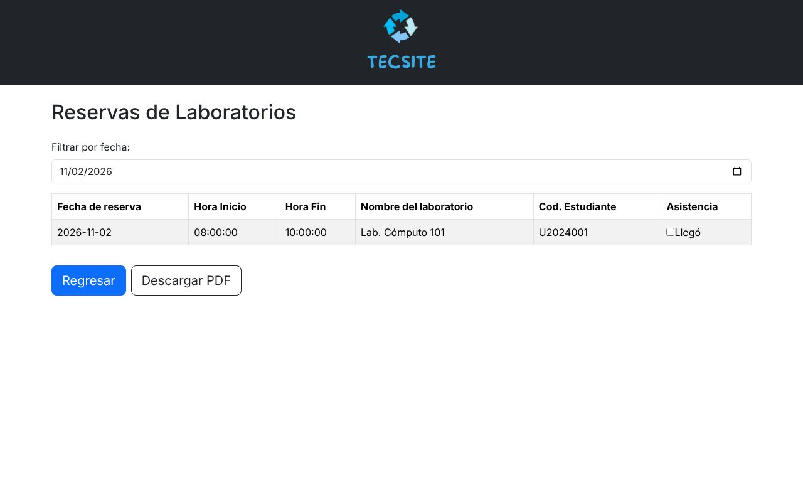

# Tecsite · Panel de administración

Panel web para administrar las reservas de **laboratorios y polideportivos** de TECSUP. Tiene una API REST en **Django REST Framework** y un frontend en **React**.

Es una de las dos partes del sistema Tecsite:

| Repo | Para quién | Stack |
|---|---|---|
| **tecs-admin** (este) | Personal administrativo | Django REST + React |
| [tecs-cliente](https://github.com/briansaa/tecs-cliente) | Alumnos | Spring Boot + React |

Las dos apps comparten la misma base de datos MySQL (`tecsite`).



## Funcionalidades

- CRUD de **usuarios, laboratorios, pabellones, polideportivos y horarios**.
- Listado de reservas por fecha, con check de asistencia ("Llegó") y **exportación a PDF**.
- **Validaciones en la API:**
  - un espacio no se puede reservar dos veces en la misma fecha y horario;
  - la hora de fin de un horario debe ser posterior a la de inicio.
- **Contraseñas con hash BCrypt.** La API nunca las devuelve. Las contraseñas antiguas en texto plano se migran solas.
- Comando `seed_demo` que carga datos de prueba.



## Stack

| Capa | Tecnología |
|---|---|
| API | Python 3.12, Django 4.2, Django REST Framework, django-cors-headers |
| Base de datos | MySQL / MariaDB (PyMySQL). Los tests usan SQLite en memoria |
| Seguridad | BCrypt, configuración por variables de entorno |
| Frontend | React 18, React Router, Bootstrap 5, Material Tailwind, jsPDF |
| CI | GitHub Actions (tests de Django y build de React) |

## Cómo correrlo

### 1. API (Django)

```bash
python -m venv venv && source venv/bin/activate   # en Windows: venv\Scripts\activate
pip install -r requirements.txt
cp .env.example .env                              # pon tu usuario y contraseña de MySQL
python manage.py migrate
python manage.py seed_demo                        # datos de prueba (usuario U2024001 / demo1234)
python manage.py runserver                         # http://127.0.0.1:8000/adminapp/api/
```

La base `tecsite` tiene que existir: `CREATE DATABASE tecsite CHARACTER SET utf8mb4;`

### 2. Panel (React)

```bash
cd admin-frontend
npm install
npm start                                         # http://localhost:3000
```

Si la API corre en otra URL, define `REACT_APP_API_URL` en `admin-frontend/.env`.

### Tests

```bash
DJANGO_TEST_SQLITE=1 python manage.py test adminapp
```

## Endpoints

Todas las rutas van con el prefijo `/adminapp/api/`. Cada recurso tiene listado/creación (`GET`, `POST`) y detalle (`GET`, `PUT`, `PATCH`, `DELETE` en `<recurso>/<id>/`).

`usuarios/` · `laboratorios/` · `pabellones/` · `polideportivos/` · `horarios/` · `reservalaboratorios/` · `reservapolideportivos/`

## Variables de entorno

Ver [`.env.example`](.env.example): `DJANGO_SECRET_KEY`, `DJANGO_DEBUG`, `DJANGO_ALLOWED_HOSTS`, `DB_*` y `CORS_ALLOWED_ORIGINS`.

## Autor

**[Brian Saavedra](https://github.com/briansaa)**. Proyecto académico de TECSUP.
